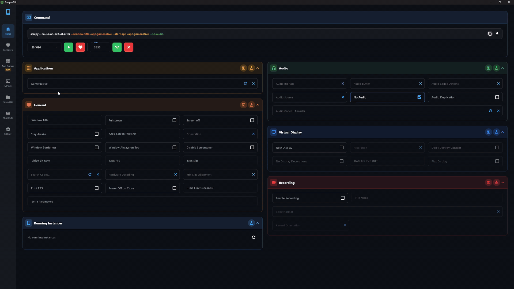

# Scrcpy GUI

[]()
[](https://github.com/microsoft/winget-pkgs/tree/master/manifests/g/GeorgeEnglezos/ScrcpyGUI)

<div align="center">
 <a href="https://trendshift.io/repositories/33319?utm_source=trendshift-badge&amp;utm_medium=badge&amp;utm_campaign=badge-trendshift-33319" target="_blank" rel="noopener noreferrer"></a> <a href="https://trendshift.io/repositories/33319?utm_source=trendshift-badge&amp;utm_medium=badge&amp;utm_campaign=badge-trendshift-33319" target="_blank" rel="noopener noreferrer"></a>
</div>

A desktop app for Windows, macOS and Linux that builds and runs [scrcpy](https://github.com/Genymobile/scrcpy) commands for you, so you can mirror and control an Android device without memorizing flags.

<div align="center">
   
</div>

## What it does

[scrcpy](https://github.com/Genymobile/scrcpy) mirrors and controls Android devices over USB or TCP/IP, with no root needed. It is a command-line tool, and Scrcpy GUI adds:

- **Visual Command Builder** - Build scrcpy commands from panels instead of memorizing flags
- **Live Preview** - See the generated command, with syntax highlighting, as you change options
- **Multi-Device Management** - Control several Android devices at once
- **Wireless Setup** - Connect a device over Wi-Fi with one click
- **Process Monitoring** - See running scrcpy instances and stop them
- **Command Favorites** - Save commands and track the ones you use most
- **App Drawer** - Launch phone apps, each in its own window

## Getting started

### Requirements

1. [scrcpy](https://github.com/Genymobile/scrcpy#get-the-app), which includes ADB:
   - Windows: `scoop install scrcpy` or `choco install scrcpy`
   - macOS: `brew install scrcpy`
   - Linux: `sudo apt install scrcpy`
2. An Android device with USB debugging on: tap Settings → About Phone → Build Number 7 times, then enable Settings → Developer Options → USB Debugging.

### Install

On Windows, winget installs the app and keeps it updated:

```
winget install GeorgeEnglezos.ScrcpyGUI
```

Otherwise, download the zip for your platform from [Releases](https://github.com/GeorgeEnglezos/Scrcpy-GUI/releases) (`scrcpy-gui-windows-vX.X.X.zip`, `scrcpy-gui-macos-vX.X.X.zip` or `scrcpy-gui-linux-vX.X.X.zip`), extract it and run the executable.

### First run

1. Connect your Android device over USB
2. Accept the USB debugging prompt on the device
3. Open Scrcpy GUI. The device appears in the dropdown within 2 seconds
4. Click the Run button to start mirroring

## Features

### Command builder

Every scrcpy option lives in a panel on the Home tab, and the command updates as you change them:

- **Common Commands** - Bitrate, resolution, FPS, orientation, window options
- **Audio Commands** - Bitrate, buffer, codec and encoder, source, duplication
- **Recording Commands** - Record to a file, with format and orientation
- **Camera Commands** - Mirror a device camera instead of the screen
- **Virtual Display** - Create a new display with its own resolution and DPI
- **Input Control** - Keyboard and mouse modes, view-only mode, button mapping
- **Network Connection** - TCP/IP connections and SSH tunnels
- **Advanced Options** - Verbosity, V4L2 sink (Linux) and cleanup flags
- **OTG Mode** - Use your keyboard and mouse on the device as if plugged into it, with no mirroring or USB debugging

<div align="center">
   <video src="Docs/media/builder.mp4" width="100%" controls muted></video>
</div>

### Devices and Wi-Fi

- **Automatic Detection** - Devices are found every 2 seconds
- **USB and Wireless** - Both connection types are supported
- **Multi-Device** - Control several devices at once
- **Device Information** - Each device's packages and codecs are cached

To go wireless, with no ADB commands to type:

1. Connect the device over USB
2. Click the Wi-Fi button next to the device dropdown
3. Unplug the cable and keep mirroring over Wi-Fi

### Favorites

- Save any command and run it again from the Favorites tab
- See your last command and the ones you run most
- Export a command as a script

<div align="center">
   <video src="Docs/media/favorites.mp4" width="100%" controls muted></video>
</div>

### App Drawer

The apps on your phone as a grid of icons on your desktop:

- **Fetch icons and labels** with the companion Helper APK or directly over ADB
- **One click to launch** an app in its own virtual display, several side by side
- **Desktop shortcuts** for any app from the right-click menu
- **Groups** to organize apps, created automatically by Android category or by hand

<div align="center">
   <video src="Docs/media/app-drawer.mp4" width="100%" controls muted></video>
</div>

### Settings

- Color theme and interface scale
- Folders for recordings, downloads, scripts and app icons
- App Drawer options and resets

<div align="center">
   <video src="Docs/media/settings.mp4" width="100%" controls muted></video>
</div>

## Platforms

| Platform | Notes |
|----------|-------|
| Windows | Windows 10 and 11 |
| macOS | 10.15 or later, Intel and Apple Silicon |
| Linux | Ubuntu 20.04 or later, Debian, Fedora, Arch |

## Web version

[scrcpy-ui.web.app](https://scrcpy-ui.web.app/) builds the same commands in a browser:

- No installation
- Works on any operating system
- Package, codec and encoder selection

## Building from source

You need the [Flutter SDK](https://docs.flutter.dev/get-started/install) (Dart ^3.9.2):

```bash
cd ScrcpyGui
flutter run -d windows    # or: -d macos / -d linux
flutter build windows     # release build
```

See the [Codebase Reference](Docs/CODEBASE_REFERENCE.md) for how the code is organized, and [Troubleshooting](Docs/TROUBLESHOOTING.md) for common problems.

## Contributing and support

1. **Report bugs** - Open an issue in [GitHub Issues](https://github.com/GeorgeEnglezos/Scrcpy-GUI/issues) with steps to reproduce
2. **Suggest features** - Share ideas in the issues too
3. **Improve the docs** - Fixes are welcome
4. **Donate** - Through PayPal

For scrcpy itself, see its [documentation](https://github.com/Genymobile/scrcpy).

## History

The project started as a .NET MAUI app for Windows. Version 1.6 moved it to Flutter to run on Windows, macOS and Linux. The MAUI version (v1.5.1) lives on, unmaintained, in [maui-scrcpy-gui](https://github.com/GeorgeEnglezos/maui-scrcpy-gui).
